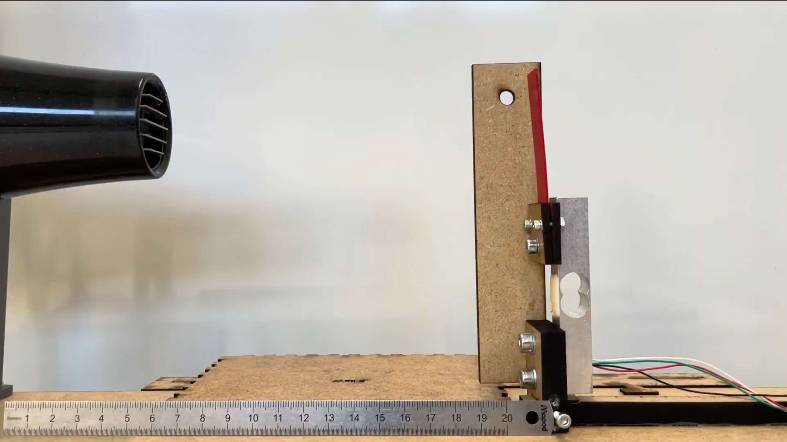

# Experimental Investigation of Wind-Induced Deformation

**EPFL · BSc Mechanical Engineering (BA6) · Measurement Techniques · 4 ECTS ·**
**Academic group project · Team of four**

**Python · OpenCV · Experimental Measurements · Fluid–Structure Interaction**

## Overview

This project investigated the deformation of a flexible strip subjected to airflow, as a simplified model of a plant bending under wind.

The objective was to design an experimental setup, implement different measurement techniques, and compare the deformation under **hot and cold airflow conditions**.

Multiple measurements were performed to assess repeatability, compare observations, and identify potential sources of experimental error and uncertainty.

### Experimental Setup

## Measurement Techniques

The project involved four categories of measurement techniques:

1. **Image-Based Processing:** Video analysis to track the deformation of the flexible strip.
2. **Sensor Measurements:** Load cell measurements of aerodynamic forces and temperature measurements of the airflow.
3. **Optical Field Measurement:** Background-Oriented Schlieren (BOS) to visualize airflow density gradients.
4. **Digital Signal Processing:** Processing and analysis of experimental measurement signals.

## My Contribution — Image Processing

I developed a Python-based image-processing tool to measure the deformation of the flexible strip from video recordings.

Using **OpenCV**, the program detects and tracks the strip through colour segmentation, calculates its displacement, and converts pixel measurements into millimetres.

**Python scripts:**
- [`pixel.py`](src/pixel.py) — Pixel-to-distance calibration.
- [`tracking_tige.py`](src/tracking_tige.py) — Automated deformation tracking.

**Experimental videos:**
- [Input video](src/video_tige.mp4) — Original experimental recording.
- [Output video](demo/tracking_output.mp4) — Processed video showing the automated tracking.

Beyond the programming work, I helped coordinate the project, contributed to the experimental methodology, and wrote most of the technical report.

## Project Documentation

This project was completed during the sixth semester of the Bachelor's degree in Mechanical Engineering at EPFL, as part of the Measurement Techniques course (4 ECTS).

The work was carried out by a team of four students.

A complete technical report was produced, covering the experimental setup, measurement methods, data analysis, uncertainties, and conclusions. The report is not publicly included in this repository.
